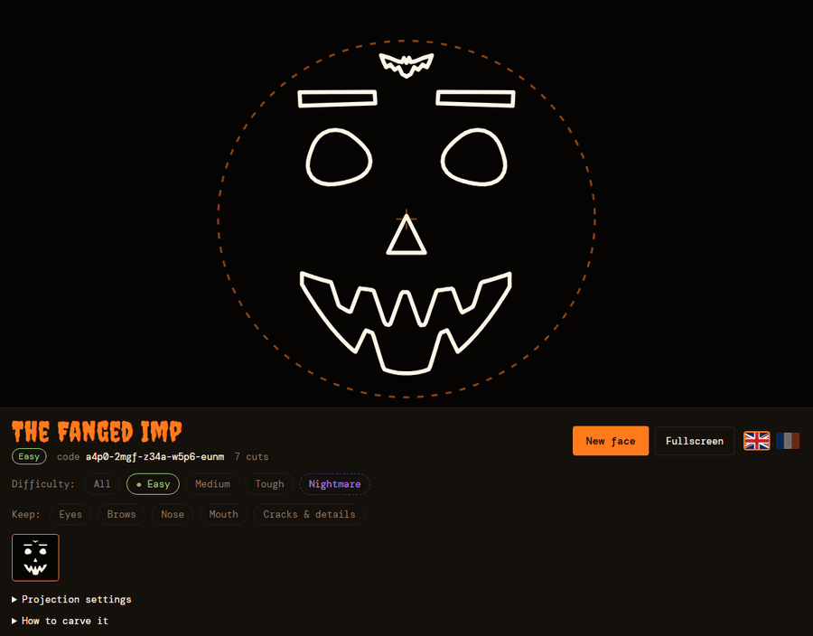
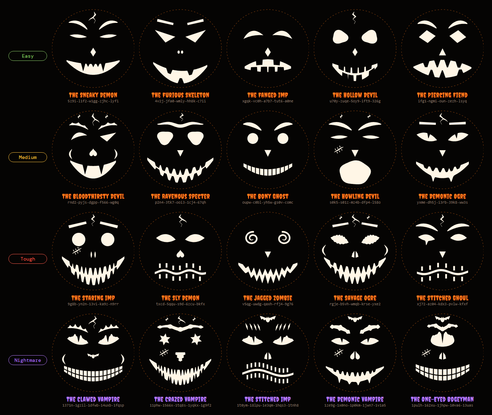
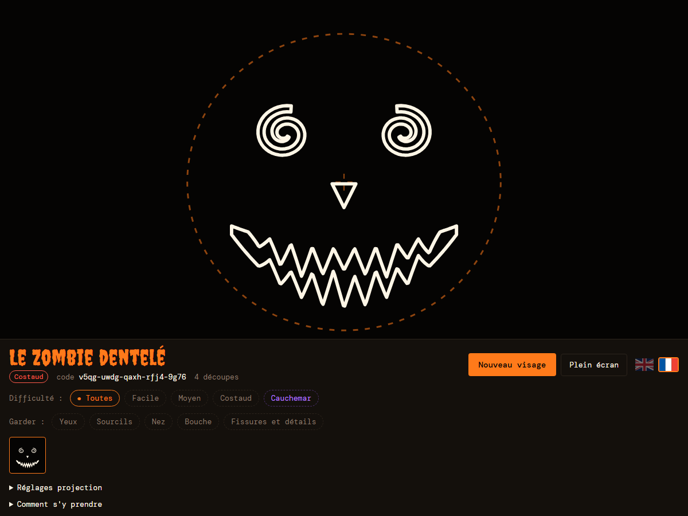

<div align="center">

# 🎃 Smashing-Pumpkins

### An endless supply of jack-o'-lantern faces, ready to project onto your pumpkin.

**A small, fun Halloween project: roll a face, keep the parts you like, pick how hard you want it, project it and carve.**

[](#quick-start)
[](#under-the-hood)
[](#under-the-hood)
[](#quick-start)
[](#english-and-french)
[](#four-levels-of-difficulty)

[Why](#why-this-project) · [Quick start](#quick-start) · [Gallery](#gallery) · [Levels](#four-levels-of-difficulty) · [Catalogue](#the-catalogue-of-shapes) · [Carving](#from-the-screen-to-the-pumpkin) · [Under the hood](#under-the-hood) · [FAQ](#faq)

<br />



</div>

---

Every October it is the same thing: you have a pumpkin, a knife, a free evening, and no idea which face to carve.
The classic triangle eyes again? A stencil found online that everybody has already done?

**Smashing-Pumpkins** is a small side project built for fun, to solve exactly that. Each click makes a new face out of
eyes, brows, a nose, a mouth and a few details, gives it a name ("The Ravenous Specter", "The Jagged Zombie") and a
difficulty. When a face makes you smile, you keep it, project it onto the pumpkin, trace the outlines and carve.
It is an idea machine: roll a dozen faces, mix the best parts, and end up with a pumpkin nobody else on the street
will have.

> [!NOTE]
> Everything fits in a single HTML file. No install, no account, no server, nothing is sent anywhere. The page works
> in any modern browser, on a computer plugged into a projector, on a tablet or on a phone.

## Why this project

|                              |                                                                                                                                                                            |
| ---------------------------- | -------------------------------------------------------------------------------------------------------------------------------------------------------------------------- |
| **Never short of ideas**     | Each part is drawn from its own catalogue (16 kinds of eyes, 6 of brows, 10 of noses, 8 of mouths, plus cracks, bats, scars and cheek lines) with random sizes and angles. |
| **Mix and match**            | Like the eyes of one face and the mouth of another? Lock the parts you want to keep: the next rolls only change the rest.                                                  |
| **Choose your challenge**    | Easy for the kids, Medium and Tough for the grown-ups, Nightmare for those who want to spend the evening on it.                                                            |
| **Made to be carved**        | Every shape is one piece of cut-out with nothing floating in the middle: pupils, teeth and fangs are tabs attached to the edge, so nothing falls out while you carve.      |
| **Made for the projector**   | Black stage, light outlines, a dashed guide that matches the pumpkin's outline, fullscreen in one click, controls hidden with one key.                                     |
| **Easy to share**            | Every face has a short code. Send it to a friend and they get exactly the same face.                                                                                       |
| **In English and in French** | Click a flag and the whole page switches language, names of the faces included.                                                                                            |

## Quick start

1. Download or clone the folder.
2. Open `citrouille.html` in your browser (a double click is enough).

That's it. If you work in VS Code with the **Live Server** extension, right click the file and pick
**Open with Live Server**: the page reloads by itself each time you change the code.

| Key or action              | Effect                                   |
| -------------------------- | ---------------------------------------- |
| `Space` or `R`             | New face                                 |
| `H` or a click on the face | Hide or show the controls                |
| **Fullscreen** button      | Fullscreen with the controls hidden      |
| **Keep** chips             | Lock eyes, brows, nose, mouth or details |
| **Difficulty** chips       | Only roll faces of that level            |
| Flags                      | Switch between English and French        |

## Gallery

A few faces rolled by the generator, five per level. Each one comes with its code: paste it into
**Projection settings > Load a code** to get the very same face.



<details>
<summary><strong>The codes of the gallery</strong></summary>

<br />

| Level     | Codes                                                                                                                                                           |
| --------- | --------------------------------------------------------------------------------------------------------------------------------------------------------------- |
| Easy      | `5z9i-l1f2-w1gg-zjhc-lyfi` `4v2j-jfa0-wmly-hh8k-c7ii` `xgqk-vc0h-a7b7-tut6-a0ne` `u70y-zuqe-5oy9-ift9-326g` `ifg1-ngmi-oun-zezh-lsyq`                           |
| Medium    | `rnd2-pyjs-dgpp-f566-wg0q` `p2n4-3tk7-ooi3-1cj4-67qh` `oupw-c0bl-yh5w-gs0v-comc` `s0k5-s01z-mz4b-dfp4-l58o` `yxme-dh5j-i3rb-39k8-ww3s`                          |
| Tough     | `9g8b-yn2n-13vi-ka9z-n9rr` `txcd-5qqu-s9d-6zcu-bkfx` `v5qg-uwdg-qaxh-rfj4-9g76` `rgje-b5vh-wmqb-krse-yxe2` `xj72-az04-kdx3-pvlw-kfxf`                           |
| Nightmare | `1371n-1gzil-1dfwb-14uxb-1fqsp` `11phw-1566x-1tq8s-1yqkx-1g9f2` `1t0ym-18lpu-1e3qm-1hqs3-1tnh8` `1ze9g-1x0no-1p0km-1jwn7-1v1a5` `1pulh-162xu-1jhpw-10va6-13uas` |

You can also add the code after a `#` in the address bar: `citrouille.html#v5qg-uwdg-qaxh-rfj4-9g76`.

</details>

## Four levels of difficulty

Each face gets a score from its number of cuts, its teeth and the delicate shapes it contains (spirals, pupils,
drips, claw marks). The score decides its level, and the **Difficulty** chips only roll faces of the chosen level.

| Level                                                                         | What to expect                                                                                                  | For whom                           |
| ----------------------------------------------------------------------------- | --------------------------------------------------------------------------------------------------------------- | ---------------------------------- |
|            | Few cuts, simple shapes: triangles, ovals, a mouth with a couple of big teeth                                   | Kids, first pumpkin, short evening |
|        | More teeth, curved brows, a skull nose, a crack or a bat                                                        | A relaxed evening                  |
|          | Rows of fangs, zigzag teeth, spirals, stitched mouths, scars                                                    | Patient hands and a sharp knife    |
|  | Its own harder catalogue: clawed eyes, spiked brows, 13 to 16 fangs, double rows of skull teeth, crack networks | The big night of the year          |

**Nightmare** is not just a filter: each part has its own harder versions, and a Nightmare face uses them for all five
parts. Its name and label turn purple. In **All** mode, about one face in ten comes out as a Nightmare.

## The catalogue of shapes

Each part is drawn from its own list, then resized, tilted and moved a little, so two faces are almost never the
same. Many of these shapes come from the most common ideas in pumpkin carving guides: angry triangle eyes, jagged
eyes, hypnotic spirals, hollow sockets, a skull nose, toothy grins, crooked teeth, vampire fangs, a stitched mouth.

| Part        | Regular shapes                                                                                                                                                          | Nightmare versions                                                                                                                       |
| ----------- | ----------------------------------------------------------------------------------------------------------------------------------------------------------------------- | ---------------------------------------------------------------------------------------------------------------------------------------- |
| **Eyes**    | Furious triangles, slits, almonds, round, droopy, diamonds, stars, dead X, hollow sockets, demon eyes with a slit pupil, spirals, jagged, melting, a single cyclops eye | Clawed lids, melting eyes with a pupil, jagged eyes with a pupil, spirals, a spiked cyclops eye                                          |
| **Brows**   | Bars, lightning bolts, heavy curved brows, flames, unibrow in a V, claw marks                                                                                           | Spiked heavy brows, big flames, spiked unibrow, four claw marks                                                                          |
| **Nose**    | Triangle, upside-down triangle, slits, two holes, diamond, skull heart, skull nostrils, split skull heart, bat                                                          | Split skull heart, bat, skull nostrils, spiky triangle                                                                                   |
| **Mouth**   | Classic teeth, big ravenous grin, vampire fangs, zigzag teeth, skeleton slots, drooling grin, howling scream, stitched                                                  | 13 to 16 fangs, deep zigzags, fangs top and bottom, two rows of skull slots, heavy drool, a scream with fangs all around, tight stitches |
| **Details** | A crack on the forehead (with or without a branch), a bat, lines on the cheeks, a stitched scar                                                                         | Crack networks, cracks on the temples, bigger bats, scars more often                                                                     |

The faces get their name from their eyes or their mouth and a list of monsters: _The Clawed Vampire_,
_The Bony Ghost_, _The Howling Devil_, _Le Croque-mitaine borgne_...

## From the screen to the pumpkin

1. **Find your face.** Roll faces with `Space`. When one part is good, lock it with **Keep** and keep rolling the rest.
2. **Set up the projector.** Point it at the pumpkin in a dark room, press **Fullscreen**.
3. **Fit the guide.** In **Projection settings**, change the **Size** and **Height** until the dashed orange line hugs
   the edge of the pumpkin. **Outline only** draws thin lines that are easy to trace; **White background** helps with
   some projectors.
4. **Trace.** Go over the projected outlines with a marker or a pen.
5. **Carve.** Small details first, the mouth last.

> [!TIP]
>
> - Scrape the inside wall down to about 2 cm (3/4 in) before carving: it cuts much more easily.
> - Teeth, fangs and pupils are tabs attached to the edge. Cut around them, never through their base.
> - For the finest lines (cracks, scars, claw marks), you can shave off the skin instead of cutting through: the
>   wall stays sturdy and the light still shows.
> - No projector? Open the face on a tablet or a phone, hold the screen against the pumpkin in the dark and trace
>   through, or print a screenshot and tape it on.

## English and French



The page opens in English. Click the French flag and everything switches: buttons, levels, help, and the names of
the faces, which follow French grammar (_The Jagged Zombie_ becomes _Le Zombie dentelé_). The choice is remembered
for the next visit. The flags are drawn in SVG inside the page, because flag emojis don't show on Windows.

## Under the hood

The whole project is one file of about 800 lines: HTML, CSS and plain JavaScript, with no library and no build step.
The only outside resource is two Google Fonts (Creepster for the titles, DM Mono for the interface).

- **Faces are drawn in SVG.** Every shape is computed as a polygon in a 400 by 400 box: lens shapes for the eyes,
  parabolas for the mouths, tapered strips for the brows and cracks, spirals, hearts and a bat silhouette.
- **One seed per part.** A small random number generator (Mulberry32) is seeded separately for the eyes, the brows,
  the nose, the mouth and the details. Locking a part simply keeps its seed. The five seeds, written in base 36,
  make the code of the face.
- **Nightmare is in the code.** A Nightmare seed is above a threshold, so its code is one character longer; the
  generators see it and switch to their hard versions.
- **No floating pieces.** The golden rule of pumpkin stencils is that whatever stays must hold to the wall. No shape
  has a hole in the middle: pupils are a point of pumpkin coming down from the eyelid, teeth come from the edge of
  the mouth, skull nostrils are two separate cuts. Shapes are also kept apart from each other, so two cuts never
  merge and trap a piece between them.
- **Nothing leaves the page.** Settings, the last 12 faces and the language are kept in the browser's local storage.

### Project structure

```text
citrouille.html    The whole app: page, styles, generators, interface
assets/            Animated GIF, screenshots and gallery used in this README
README.md          This file
```

## FAQ

<details>
<summary><strong>Do I need a projector?</strong></summary>

No. A projector is the most comfortable way to trace, but you can also hold a tablet or a phone against the pumpkin
in the dark, or print a screenshot of the face and tape it on.

</details>

<details>
<summary><strong>Why does the face I loaded look different from before?</strong></summary>

The catalogue of shapes grows from one version to the next, so an old code may now give another face. The codes in
this README match the current version.

</details>

<details>
<summary><strong>The "Keep" chips are on but nothing matches the level I picked.</strong></summary>

The locked parts may make the level impossible: a locked mouth with 16 fangs will never give an Easy face. The page
tells you so; unlock one part and roll again.

</details>

<details>
<summary><strong>Can I add my own shapes?</strong></summary>

Yes. Eyes are listed in the `EYES` object, mouths in `MOUTHS`, and the brows, noses and details in their `gen...`
functions. Each entry returns a list of points; add yours, give it a weight in the regular and Nightmare lists, and
it will start showing up in the rolls. Just keep the golden rule: one piece, nothing floating in the middle.

</details>

<details>
<summary><strong>Does it work offline?</strong></summary>

Yes, once the page is open. Without a connection on the first visit, only the two fonts are missing and the page
falls back to the system fonts.

</details>
